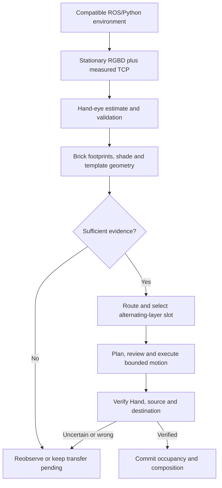

# Algorithm and decision guide

This guide explains the actual engineering choices in the saved reference: the method, why it was chosen, what failed, what was observed to work, and what remains unproven. It describes the conversation/snapshot boundary, not additional robot work performed in this side conversation.

## Read block by block

| Block | Algorithm and reasoning |
|---|---|
| 00 Environment and process isolation | [Detailed decision guide](blocks/00_environment/ALGORITHM_AND_DECISIONS.md) |
| 01 Robot control and motion review | [Detailed decision guide](blocks/01_robot_control/ALGORITHM_AND_DECISIONS.md) |
| 02 RGBD acquisition and auxiliary observation | [Detailed decision guide](blocks/02_cameras/ALGORITHM_AND_DECISIONS.md) |
| 03 Camera-to-TCP estimation | [Detailed decision guide](blocks/03_handeye_calibration/ALGORITHM_AND_DECISIONS.md) |
| 04 Brick geometry, shade classification and templates | [Detailed decision guide](blocks/04_perception/ALGORITHM_AND_DECISIONS.md) |
| 05 Routing, alternating layers and grasp strategy | [Detailed decision guide](blocks/05_sorting_and_manipulation/ALGORITHM_AND_DECISIONS.md) |
| 06 Evidence-driven commissioning and failure handling | [Detailed decision guide](blocks/06_commissioning_and_recovery/ALGORITHM_AND_DECISIONS.md) |

## How the blocks connect

## Read the success claims precisely

- **Implemented:** source code exists; this does not prove the behavior on hardware.
- **Offline/numerically validated:** specified tests or calibration consistency checks passed.
- **Observed hardware result:** a specific physical trial has saved feedback/images.
- **Task success:** the brick reaches the correct destination, slot and layer orientation with verification. The first recorded placement did not meet that definition.

The established physical result is one isolated maroon pick and release. The release was parallel to the previous layer and off center, so it was a task failure. Correct dense-pallet extraction, complete interlocking layers, measured repeated-layer pitch and both full request modes remain undemonstrated at this boundary. Replacement fingertips were supplied but were not commissioned in this reference handoff.

The rationale here is an engineering explanation and retrospective of the methods and evidence. It does not invent measurements, turn proposed corrections into completed trials, or provide a clean-machine/hardware reliability claim.
